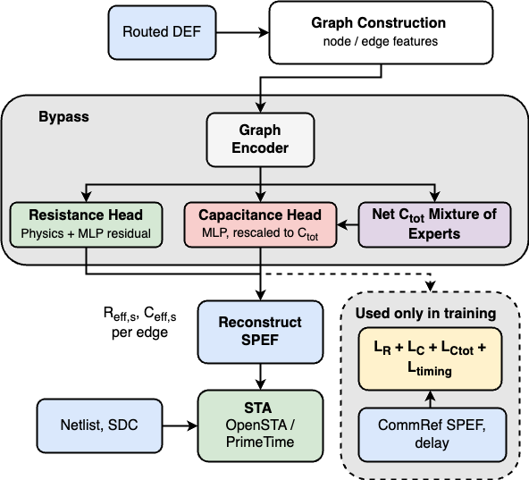
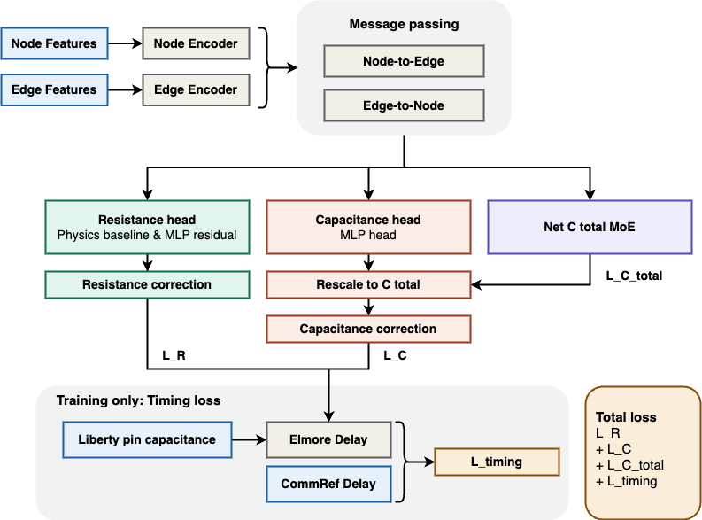

# Models

Bypass is a physics-guided graph neural network that predicts the resistance (R) and capacitance (C) of every routed segment (edge) of a net from the routed DEF alone. It needs no extraction technology file and no extraction run at inference time. The prediction is written as a SPEF that OpenSTA and PrimeTime read in place of an extracted one.



Bypass takes as input the routed DEF of a design. Each net is turned into a graph whose nodes are the points of its routed tree (pins and Steiner points) and whose edges are the routed segments between them, with features on both. A graph neural network encodes this graph into an embedding for every edge. From the embedding, one head predicts the resistance of the edge. A second head predicts its capacitance, scaled so that the edges of a net add up to the total capacitance of the net, which a third head predicts for the whole net. The effective resistance and capacitance of every edge are then written as a SPEF, and OpenSTA or PrimeTime reads this SPEF together with the netlist and the timing constraints, in place of an extracted SPEF. The model is trained against the Commercial reference (CommRef) SPEF and the OpenSTA delay. During training only, the predicted R and C are scored against the CommRef values and, through a delay computation, against the OpenSTA delay. This step is not part of inference.

Bypass is compared with two baselines, the [Technology-Table Heuristic (Tech.)](#technology-table-heuristic-tech) and the [Machine-Learning Baseline (ML)](#machine-learning-baseline-ml). All methods take the same input, the features extracted from the routed DEF (`scripts/data_processing/build_testing_dataset`), and write their SPEF through the same code ([common/](#common-code)), so the SPEFs differ only in the predicted R and C. The results of the comparison are in [results/README.md](../results/README.md). To train the model or to predict the SPEF of a new design, see the [main README](../README.md).

## Bypass

Bypass is a graph neural network over the routed tree of each net. It has four components: an edge-aware graph encoder, a resistance head, a two-level capacitance head and a timing-coupled loss. The graph encoder produces a contextualized embedding for every edge of the net. The resistance head refines a per-layer, per-via linear baseline with learned log-scale corrections. The capacitance head predicts the relative share of each edge and rescales it to a predicted net-level total. The timing-coupled loss trains both heads jointly through a differentiable Elmore delay.



Node and edge features are first encoded separately and are then combined over the routed tree by message passing, which alternates between updating the nodes from their incident edges and updating the edges from their two endpoints. The resulting edge embeddings feed the resistance and the capacitance branches. The resistance branch starts from a physics baseline, refines it with a learned residual and applies a second, timing-based correction. The capacitance branch predicts the relative capacitance of each edge with an MLP, rescales these values to the net total predicted by a net-level mixture of experts, and applies a second correction as well. The net total is also supervised on its own. A third part exists only during training. The corrected resistance and capacitance, together with the pin capacitances from the Liberty library, give an Elmore delay that is compared with the CommRef delay. The total loss is the sum of the resistance loss, the capacitance loss, the net-total capacitance loss and the timing loss.

### Inference and SPEF Reconstruction

At inference, Bypass takes a routed DEF and needs no SPEF and no technology file. The graph of each net is built directly from the DEF, and the trained model predicts the effective R and C of every edge. The predicted RC tree of each net is then written as a standard SPEF, which OpenSTA and PrimeTime read together with the netlist and the constraints of the design, in place of an extracted SPEF.

## Bypass Capacitance Calibration

Bypass underestimates the capacitance of the long nets of designs that are larger than those of the training data. The calibration scales the capacitance of each net of the Bypass SPEF by a factor that depends only on the routed geometry of the net. The factor is fitted on the validation nets and needs no CommRef data at inference. The effect on the capacitance and on timing is reported in [Section 4 of the results](../results/README.md#4-capacitance-calibration). The method, the files and the commands are described in the [post-calibration README](bypass/post-calibration/README.md).

## Comparison Methods

The baselines of the comparison are the Technology-Table Heuristic (Tech.) and the Machine-Learning Baseline (ML). Neither baseline propagates information along the routed tree of a net.

### Technology-Table Heuristic (Tech.)

The prediction uses the NanGate45 technology tables, with no training.

- Resistance of an edge: the length on each metal layer times the resistance per um of that layer, plus a uniform 3 ohm per via.
- Capacitance of an edge: the length on each metal layer times the capacitance per um of that layer.

The method is a reference for what a technology table alone gives. It does not see routing density or the structure of the net.

### Machine-Learning Baseline (ML)

The ML baseline uses the same physics idea as Bypass but predicts every edge on its own, so it shows what the routed-tree structure of Bypass adds. It is trained on the same data and validated on the same runs as Bypass.

- **Resistance:** the same physical relation as in Bypass (length on each layer and via resistance, with learned coefficients), multiplied by a factor that a small MLP predicts from the features of the edge. The coefficients start from the technology values.
- **Capacitance of an edge:** a random forest (300 trees, depth 15) on a log target. The training also reports the technology coefficients and a non-negative least-squares linear fit as references.

## Code Layout

```
models/
├── bypass/
│   ├── train.py               Bypass model definition and training
│   ├── run_inference.py       Bypass inference
│   └── post-calibration/      README.md, fit_calibration.py, apply_calibration.py, net_features.py
├── ML/
│   ├── train_r.py             R: physics term and MLP residual
│   ├── train_c_edge.py        C of an edge: random forest
│   └── run_inference.py
├── Tech/
│   └── run_inference.py       technology tables, nothing to train
└── common/
    ├── graph_builder.py       nets to graphs, differentiable Elmore delay
    ├── inference_engine.py    loop over designs, batches, SPEF output
    └── spef_writer_ports.py   SPEF writer
```

### Common code

| File | Content |
|:---|:---|
| `graph_builder.py` | Builds the graph of each net from the feature tables, reads the DEF ports and the Liberty pin capacitances, and computes the differentiable Elmore delay used in the timing term |
| `inference_engine.py` | Runs the model over the test designs and writes the per-edge predictions, the net totals and the SPEF. Tech., ML and Bypass share this code, so the three SPEFs differ only in the predicted R and C. |
| `spef_writer_ports.py` | Writes the predicted SPEF |
