# Results

Trained models and detailed results for the ten test designs: four `aes_cipher_top` configurations, two `ldpc_decoder_mod`, `vga_enh_top`, `swerv_wrapper`, `tate_pairing` and `mpeg2_top`. None of them is among the training or validation runs.

- **Section 1** includes the result tables of the paper **"Bypass: Physics-Guided Parasitic Extraction Without Technology Files"**, submitted to International Symposium on Circuits and Systems (ISCAS) 2027.
- **Sections 2 to 4** give the per-design results, the net-length and routing-density analysis, the component ablation in PrimeTime and OpenSTA, and the capacitance calibration.

| Section | Content |
|:---|:---|
| [1. Results from the paper](#1-results-from-the-paper) | Tables I to IV of the paper |
| [2. Model targets](#2-model-targets) | Per-design accuracy of the predicted R and C |
| [3. STA analysis](#3-sta-analysis) | Timing with the predicted SPEF in OpenSTA and PrimeTime |
| [4. Capacitance calibration](#4-capacitance-calibration) | Net-level post-processing of the predicted capacitance |

## Compared Methods

All methods predict the resistance and capacitance of every routed segment (edge) of a net from the routed DEF only, and the predictions are written as a SPEF that OpenSTA and PrimeTime read in place of an extracted one. Details of each model are in [models/README.md](../models/README.md).

## Contents

```
results/
├── model/bypass.pt      Bypass model
├── ML/                  baselines: baseline_r/baseline_r.pt
├── model_targets/       CSV tables of Section 2
├── sta_analysis/        CSV tables of Sections 1 and 3
├── calibration/         calibration coefficients and their effect on the capacitance (Section 4)
└── figures/             plots drawn from the CSV files
```

---

## 1. Results from the Paper

### 1.1 Test Designs

| Design | Cells | Nets | Layers | Fanout avg (max) | WL (mm) |
|:---|---:|---:|:---|:---|---:|
| aes_cipher_top_0.6_0.4_1.0 | 19,263 | 20,116 | 8 (M3–M10) | 2.09 (63) | 322.7 |
| aes_cipher_top_0.75_0.4_1.0 | 14,878 | 15,755 | 8 (M3–M10) | 2.35 (73) | 311.2 |
| aes_cipher_top_0.9_0.4_1.0 | 12,906 | 13,745 | 8 (M3–M10) | 2.52 (70) | 303.9 |
| aes_cipher_top_3_0.92_1.2 | 11,327 | 12,167 | 5 (M2–M6) | 2.63 (66) | 174.5 |
| ldpc_decoder_mod_1.0_0.3_1.0 | 67,563 | 73,475 | 8 (M3–M10) | 1.96 (73) | 3333.8 |
| ldpc_decoder_mod_1.6_0.4_1.0 | 43,269 | 49,312 | 8 (M3–M10) | 2.28 (75) | 2350.9 |
| vga_enh_top_1.0_0.6_1.0 | 33,351 | 50,913 | 8 (M3–M10) | 3.61 (75) | 1153.1 |
| swerv_wrapper_1.0_0.7_1.0 | 105,285 | 130,723 | 8 (M3–M10) | 2.60 (75) | 3554.9 |
| tate_pairing_1.0_0.6_1.0 | 222,492 | 276,847 | 8 (M3–M10) | 2.50 (75) | 4170.3 |
| mpeg2_top_1.0_0.6_1.0 | 293,775 | 421,913 | 8 (M3–M10) | 3.51 (75) | 8671.7 |

Five of the six design families are not seen in training. The `aes_cipher_top` test configurations are disjoint from the training configurations. `swerv_wrapper` contains 28 hard macros.

### 1.2 Metrics

MedAPE and WMAPE are reported in %.

For each edge or net *i* of a design, *p<sub>i</sub>* and *g<sub>i</sub>* denote the predicted and Commercial Reference (CommRef) values, respectively. The metrics are defined as

```
APE_i  = |p_i - g_i| / g_i
MedAPE = 100 x median of APE_i over all i
WMAPE  = 100 x sum of |p_i - g_i| / sum of g_i
R²     = 1 - sum of (p_i - g_i)² / sum of (g_i - mean(g))²
```

>We use Cadence Genus, Innovus and Quantus, and Synopsys PrimeTime, as leading examples of commercial EDA tools: Genus for logic synthesis, Innovus for place and route, Quantus for parasitic extraction (the CommRef SPEFs) and PrimeTime for static timing analysis. Our methods and studies apply straightforwardly to other tools of the same kind. We do not benchmark commercial EDA tools. No value judgments are intended or should be inferred.

**MedAPE** captures the typical relative error, so a few extreme values do not change it. In contrast, **MAPE** (mean APE) is dominated by the many edges with very small CommRef values, which give very large APE. **WMAPE** weights each error by its CommRef value, so that very small values cannot dominate. **MedAPE** measures the error of a typical edge or net, whereas **WMAPE** measures the total error, where larger values count more. This determines the accuracy of the total design capacitance. Finally, **R²** measures how well the predictions track the CommRef values over the full range. WMAPE is labeled "Wtd." in the paper.

For timing, the **endpoint error** is the predicted minus the CommRef rise arrival time, so a negative value indicates an early arrival. **ΔWNS** is the predicted minus the CommRef worst negative slack. **Ceiling** is the SPEF built from the CommRef R and C in the representation of Bypass (capacitance fold and π-model reconstruction), i.e., the error that remains for a perfect prediction.

### 1.3 Parasitic Accuracy (Table I)

Averaged over the ten test designs. Source: `model_targets/target_accuracy_per_design.csv`.

| Method | R edge, MedAPE | R edge, WMAPE | R edge, R² | C edge, MedAPE | C edge, WMAPE | C edge, R² | C net, MedAPE | C net, WMAPE | C net, R² |
|:---|---:|---:|---:|---:|---:|---:|---:|---:|---:|
| Tech. | 30.7 | 25.4 | 0.90 | 41.7 | 38.0 | 0.48 | 28.3 | 23.9 | 0.83 |
| ML | 14.9 | 16.0 | **0.94** | 21.5 | 27.6 | **0.88** | 10.6 | 18.8 | 0.92 |
| Bypass | **6.8** | **11.1** | **0.94** | **15.1** | **23.0** | **0.88** | **10.0** | **15.7** | **0.94** |

- *Edge resistance.* Bypass has the lowest MedAPE on every design (6.2 to 8.2%), about half that of ML and a quarter that of Tech. R² is the same as ML because it is dominated by the few largest edges, where both methods are accurate.
- *Edge capacitance.* This is the hardest target for every method. Tech. has R² 0.48 on average and below zero on two designs, i.e., worse than predicting the mean.
- *Net-total capacitance.* Per-edge errors partly cancel within a net, so all methods are more accurate on the net total. Bypass and ML are close in MedAPE, and WMAPE separates them because it weights the long, high-capacitance nets.
- Per-design values and the Elmore arc delay are in [Section 2.1](#21-accuracy-of-the-predicted-r-and-c).

### 1.4 Interconnect (Arc) Delay (Table II)

MedAPE (%) of the net delay per driver-to-receiver arc, against the CommRef SPEF in the same tool. Source: `sta_analysis/`.

| Design | Tech. (PT) | ML (PT) | Bypass (PT) | Tech. (OpenSTA) | ML (OpenSTA) | Bypass (OpenSTA) |
|:---|---:|---:|---:|---:|---:|---:|
| aes_cipher_top_0.6_0.4_1.0 | 27.1 | 10.1 | **4.5** | 25.0 | 12.4 | **5.0** |
| aes_cipher_top_0.75_0.4_1.0 | 25.6 | 9.5 | **4.7** | 23.0 | 11.7 | **5.4** |
| aes_cipher_top_0.9_0.4_1.0 | 25.5 | 9.7 | **4.6** | 23.2 | 12.1 | **5.5** |
| aes_cipher_top_3_0.92_1.2 | 15.9 | 11.2 | **5.1** | 16.1 | 13.0 | **5.7** |
| ldpc_decoder_mod_1.0_0.3_1.0 | 34.1 | 19.3 | **7.0** | 32.3 | 20.0 | **7.2** |
| ldpc_decoder_mod_1.6_0.4_1.0 | 34.6 | 23.0 | **8.3** | 33.3 | 23.5 | **8.6** |
| vga_enh_top_1.0_0.6_1.0 | 19.8 | 12.9 | **6.4** | 17.9 | 14.5 | **6.4** |
| swerv_wrapper_1.0_0.7_1.0 | 21.0 | 13.8 | **5.7** | 20.8 | 12.5 | **5.4** |
| tate_pairing_1.0_0.6_1.0 | 25.0 | 11.5 | **6.2** | 28.5 | 13.9 | **6.4** |
| mpeg2_top_1.0_0.6_1.0 | 22.6 | 15.8 | **5.6** | 20.4 | 15.3 | **5.4** |

- Bypass has the lowest error on all ten designs in both tools.
- PrimeTime is not used to produce any training label, and the methods keep the same order in both tools.
- The Ceiling is at 0.0 to 0.1% (PrimeTime) and 0.1 to 0.6% (OpenSTA). The capacitance fold and π-model reconstruction cost almost nothing, so the remaining error is the prediction itself.
- Scatter plots and the error by delay range are in [Section 3.2](#32-interconnect-arc-delay).

### 1.5 Endpoint Arrival Time (Table III)

Median absolute endpoint error (ps), PrimeTime. *Bypass Cal.* applies the calibration of [Section 4](#4-capacitance-calibration). Source: `sta_analysis/endpoint_metrics.csv`, `sta_analysis/calibration_primetime.csv`.

| Design | Ceiling | Tech. | ML | Bypass | Bypass Cal. |
|:---|---:|---:|---:|---:|---:|
| aes_cipher_top_0.6_0.4_1.0 | 0.05 | 6.7 | 4.6 | 4.9 | 2.2 |
| aes_cipher_top_0.75_0.4_1.0 | 0.04 | 9.5 | 5.2 | 4.9 | 2.1 |
| aes_cipher_top_0.9_0.4_1.0 | 0.04 | 9.0 | 8.7 | 9.4 | 3.5 |
| aes_cipher_top_3_0.92_1.2 | 0.03 | 7.2 | 15.3 | 12.6 | 8.7 |
| ldpc_decoder_mod_1.0_0.3_1.0 | 4.6 | 14.0 | 103.0 | 59.8 | 35.6 |
| ldpc_decoder_mod_1.6_0.4_1.0 | 1.2 | 103.9 | 203.8 | 97.2 | 34.4 |
| vga_enh_top_1.0_0.6_1.0 | 0.3 | 5.8 | 24.0 | 30.3 | 17.4 |
| swerv_wrapper_1.0_0.7_1.0 | 8.5 | 25.4 | 86.2 | 45.9 | 15.6 |
| tate_pairing_1.0_0.6_1.0 | 2.6 | 10.2 | 45.8 | 39.5 | 18.4 |
| mpeg2_top_1.0_0.6_1.0 | 6.2 | 10.8 | 99.8 | 65.1 | 35.2 |

- *Bypass is early on every design.* Its signed median error is negative on all ten designs, in both tools. The cause is the underestimated net capacitance ([Section 3.6](#36-component-ablation)).
- *The error is small where the capacitance bias is small.* It is 4.9 to 12.6 ps on the four `aes_cipher_top` designs, and larger on designs whose nets are longer and denser than in training ([Section 2.2](#22-net-total-capacitance-net-length-and-routing-density)).
- *Tech. has a smaller median than Bypass on seven of ten designs.* It overestimates some nets and underestimates others, and these errors cancel over a typical path. The cost appears in the tail and in the worst slack: on `aes_cipher_top_0.9_0.4_1.0`, Tech. has a median of 9.0 ps, but 1% of endpoints exceed 159 ps and its ΔWNS is −210.0 ps.
- *Calibration reduces the error on all ten designs* (mean 37.0 to 17.3 ps).

### 1.6 Worst Slack (Table IV)

ΔWNS (ps), PrimeTime. A positive value means the predicted worst slack is larger (optimistic) than CommRef.

| Design | Tech. | ML | Bypass | Bypass Cal. |
|:---|---:|---:|---:|---:|
| aes_cipher_top_0.6_0.4_1.0 | −15.9 | +8.6 | +5.7 | −0.6 |
| aes_cipher_top_0.75_0.4_1.0 | −88.5 | −5.2 | +2.8 | −5.3 |
| aes_cipher_top_0.9_0.4_1.0 | −210.0 | −4.9 | +4.6 | −10.1 |
| aes_cipher_top_3_0.92_1.2 | +68.4 | +46.8 | +59.5 | +39.0 |
| ldpc_decoder_mod_1.0_0.3_1.0 | −55.4 | +84.1 | +3.2 | −29.9 |
| ldpc_decoder_mod_1.6_0.4_1.0 | −200.4 | +170.2 | +73.6 | −13.5 |
| vga_enh_top_1.0_0.6_1.0 | −150.8 | −17.5 | −0.5 | −13.8 |
| swerv_wrapper_1.0_0.7_1.0 | −149.3 | +146.4 | +99.2 | +48.9 |
| tate_pairing_1.0_0.6_1.0 | −187.8 | −21.1 | +19.2 | +5.3 |
| mpeg2_top_1.0_0.6_1.0 | −242.4 | +3.7 | −29.6 | −40.1 |
| Mean \|ΔWNS\| | 136.9 | 50.9 | 29.8 | 20.7 |

- *Bypass has the smallest \|ΔWNS\| on eight of ten designs.* It is within 6 ps on five designs.
- *Tech. is pessimistic* on nine of ten designs, up to −242.4 ps, because the longest nets, which dominate the critical path, are overestimated. *ML can be strongly optimistic*, up to +170.2 ps.
- *ΔWNS is a single path*, so it does not follow the median endpoint error. For Tech., \|ΔWNS\| exceeds the median endpoint error on all ten designs.
- *Calibration improves ΔWNS on average and in the worst case, but not on every design.* The maximum goes from 99.2 to 48.9 ps. \|ΔWNS\| increases on five designs, on all of which the uncalibrated \|ΔWNS\| was already 29.6 ps or less ([Section 4.3](#43-effect-on-timing-primetime)).
- ΔWNS in OpenSTA is in [Section 3.4](#34-worst-slack).

---

## 2. Model Targets

### 2.1 Accuracy of the Predicted R and C

Per-design values behind Table I. Metrics are defined in [Section 1.2](#12-metrics). Source: `model_targets/target_accuracy_per_design.csv`.

*Edge resistance*

| Design | MedAPE, Tech. | MedAPE, ML | MedAPE, Bypass | WMAPE, Tech. | WMAPE, ML | WMAPE, Bypass | R², Tech. | R², ML | R², Bypass |
|:---|---:|---:|---:|---:|---:|---:|---:|---:|---:|
| aes_cipher_top_0.6_0.4_1.0 | 32.1 | 14.2 | 6.2 | 28.8 | 15.4 | 10.4 | 0.79 | 0.92 | 0.92 |
| aes_cipher_top_0.75_0.4_1.0 | 30.3 | 14.1 | 6.6 | 27.2 | 15.3 | 11.5 | 0.82 | 0.92 | 0.91 |
| aes_cipher_top_0.9_0.4_1.0 | 31.2 | 15.3 | 6.3 | 28.0 | 17.2 | 9.7 | 0.83 | 0.92 | 0.93 |
| aes_cipher_top_3_0.92_1.2 | 19.5 | 14.8 | 6.3 | 21.4 | 18.5 | 11.0 | 0.90 | 0.91 | 0.93 |
| ldpc_decoder_mod_1.0_0.3_1.0 | 35.7 | 13.5 | 6.5 | 22.0 | 11.9 | 9.7 | 0.96 | 0.98 | 0.98 |
| ldpc_decoder_mod_1.6_0.4_1.0 | 36.2 | 15.1 | 6.3 | 25.2 | 15.3 | 9.3 | 0.94 | 0.96 | 0.97 |
| vga_enh_top_1.0_0.6_1.0 | 26.3 | 16.5 | 7.3 | 24.4 | 18.7 | 11.3 | 0.91 | 0.93 | 0.92 |
| swerv_wrapper_1.0_0.7_1.0 | 32.6 | 14.6 | 6.9 | 24.6 | 14.3 | 10.8 | 0.96 | 0.98 | 0.97 |
| tate_pairing_1.0_0.6_1.0 | 35.3 | 15.6 | 8.2 | 27.0 | 16.2 | 14.4 | 0.93 | 0.96 | 0.94 |
| mpeg2_top_1.0_0.6_1.0 | 28.4 | 15.6 | 7.7 | 25.6 | 16.6 | 13.1 | 0.91 | 0.94 | 0.93 |

*Edge capacitance*

| Design | MedAPE, Tech. | MedAPE, ML | MedAPE, Bypass | WMAPE, Tech. | WMAPE, ML | WMAPE, Bypass | R², Tech. | R², ML | R², Bypass |
|:---|---:|---:|---:|---:|---:|---:|---:|---:|---:|
| aes_cipher_top_0.6_0.4_1.0 | 41.8 | 18.5 | 11.1 | 40.6 | 22.6 | 16.7 | −0.04 | 0.92 | 0.92 |
| aes_cipher_top_0.75_0.4_1.0 | 41.5 | 20.3 | 11.7 | 39.7 | 23.3 | 17.3 | 0.30 | 0.90 | 0.91 |
| aes_cipher_top_0.9_0.4_1.0 | 42.6 | 21.0 | 12.1 | 43.6 | 24.1 | 18.3 | −0.12 | 0.90 | 0.91 |
| aes_cipher_top_3_0.92_1.2 | 42.1 | 21.9 | 17.3 | 38.7 | 26.5 | 23.9 | 0.86 | 0.91 | 0.87 |
| ldpc_decoder_mod_1.0_0.3_1.0 | 40.0 | 24.2 | 17.9 | 35.1 | 35.2 | 28.8 | 0.79 | 0.80 | 0.87 |
| ldpc_decoder_mod_1.6_0.4_1.0 | 42.2 | 27.2 | 20.2 | 41.0 | 35.1 | 28.8 | 0.66 | 0.83 | 0.88 |
| vga_enh_top_1.0_0.6_1.0 | 39.5 | 18.3 | 16.9 | 33.3 | 25.0 | 25.0 | 0.71 | 0.90 | 0.86 |
| swerv_wrapper_1.0_0.7_1.0 | 42.7 | 21.6 | 13.3 | 37.0 | 26.9 | 22.7 | 0.56 | 0.90 | 0.88 |
| tate_pairing_1.0_0.6_1.0 | 43.5 | 22.4 | 16.4 | 34.4 | 29.2 | 26.8 | 0.57 | 0.88 | 0.84 |
| mpeg2_top_1.0_0.6_1.0 | 40.6 | 19.5 | 14.1 | 36.9 | 27.8 | 21.9 | 0.53 | 0.86 | 0.88 |

*Net-total capacitance*

| Design | MedAPE, Tech. | MedAPE, ML | MedAPE, Bypass | WMAPE, Tech. | WMAPE, ML | WMAPE, Bypass | R², Tech. | R², ML | R², Bypass |
|:---|---:|---:|---:|---:|---:|---:|---:|---:|---:|
| aes_cipher_top_0.6_0.4_1.0 | 30.4 | 9.2 | 8.2 | 28.1 | 13.1 | 10.4 | 0.66 | 0.96 | 0.97 |
| aes_cipher_top_0.75_0.4_1.0 | 27.3 | 9.2 | 7.6 | 24.7 | 12.4 | 10.1 | 0.77 | 0.96 | 0.97 |
| aes_cipher_top_0.9_0.4_1.0 | 27.9 | 8.9 | 7.6 | 27.6 | 12.4 | 10.6 | 0.65 | 0.96 | 0.97 |
| aes_cipher_top_3_0.92_1.2 | 33.2 | 10.9 | 9.8 | 27.6 | 12.2 | 14.6 | 0.91 | 0.97 | 0.95 |
| ldpc_decoder_mod_1.0_0.3_1.0 | 32.2 | 14.8 | 15.0 | 29.6 | 32.6 | 24.2 | 0.85 | 0.80 | 0.90 |
| ldpc_decoder_mod_1.6_0.4_1.0 | 34.0 | 15.5 | 17.0 | 31.3 | 31.5 | 23.4 | 0.87 | 0.83 | 0.91 |
| vga_enh_top_1.0_0.6_1.0 | 20.5 | 8.2 | 8.8 | 11.6 | 14.8 | 16.5 | 0.98 | 0.95 | 0.93 |
| swerv_wrapper_1.0_0.7_1.0 | 29.1 | 11.1 | 8.6 | 24.6 | 20.2 | 15.9 | 0.80 | 0.92 | 0.94 |
| tate_pairing_1.0_0.6_1.0 | 26.6 | 9.9 | 9.6 | 19.7 | 20.2 | 18.9 | 0.85 | 0.90 | 0.93 |
| mpeg2_top_1.0_0.6_1.0 | 21.7 | 8.7 | 8.1 | 14.8 | 18.5 | 11.9 | 0.96 | 0.91 | 0.96 |

*Arc (Elmore) delay*

| Design | MedAPE, Tech. | MedAPE, ML | MedAPE, Bypass | WMAPE, Tech. | WMAPE, ML | WMAPE, Bypass | R², Tech. | R², ML | R², Bypass |
|:---|---:|---:|---:|---:|---:|---:|---:|---:|---:|
| aes_cipher_top_0.6_0.4_1.0 | 25.0 | 12.4 | 5.0 | 16.2 | 15.1 | 6.8 | 0.97 | 0.95 | 0.99 |
| aes_cipher_top_0.75_0.4_1.0 | 23.1 | 11.6 | 5.3 | 17.4 | 17.5 | 6.8 | 0.93 | 0.90 | 1.00 |
| aes_cipher_top_0.9_0.4_1.0 | 23.3 | 12.1 | 5.4 | 19.3 | 14.6 | 7.1 | 0.92 | 0.94 | 0.99 |
| aes_cipher_top_3_0.92_1.2 | 16.3 | 12.7 | 5.6 | 11.5 | 16.5 | 8.0 | 0.98 | 0.95 | 0.99 |
| ldpc_decoder_mod_1.0_0.3_1.0 | 32.9 | 20.1 | 6.9 | 21.5 | 23.7 | 12.6 | 0.95 | 0.92 | 0.97 |
| ldpc_decoder_mod_1.6_0.4_1.0 | 34.3 | 23.5 | 8.1 | 23.9 | 27.1 | 13.8 | 0.93 | 0.90 | 0.97 |
| vga_enh_top_1.0_0.6_1.0 | 18.0 | 14.5 | 6.4 | 10.9 | 15.1 | 10.7 | 0.99 | 0.97 | 0.97 |
| swerv_wrapper_1.0_0.7_1.0 | 21.0 | 12.3 | 5.3 | 14.7 | 15.7 | 6.9 | 0.96 | 0.95 | 0.99 |
| tate_pairing_1.0_0.6_1.0 | 25.1 | 13.5 | 6.5 | 12.3 | 13.9 | 7.0 | 0.98 | 0.97 | 0.99 |
| mpeg2_top_1.0_0.6_1.0 | 20.4 | 15.3 | 5.4 | 16.8 | 17.7 | 6.0 | 0.96 | 0.95 | 0.99 |

#### Plots

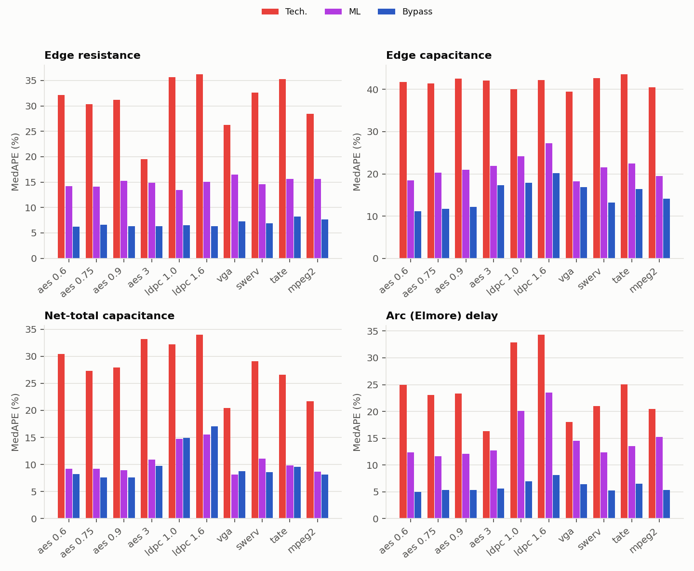

The next three figures show Bypass against CommRef for every edge or net of each design, with the diagonal as reference. The title of each plot shows the R² of the table of [Section 2](#2-model-targets). 

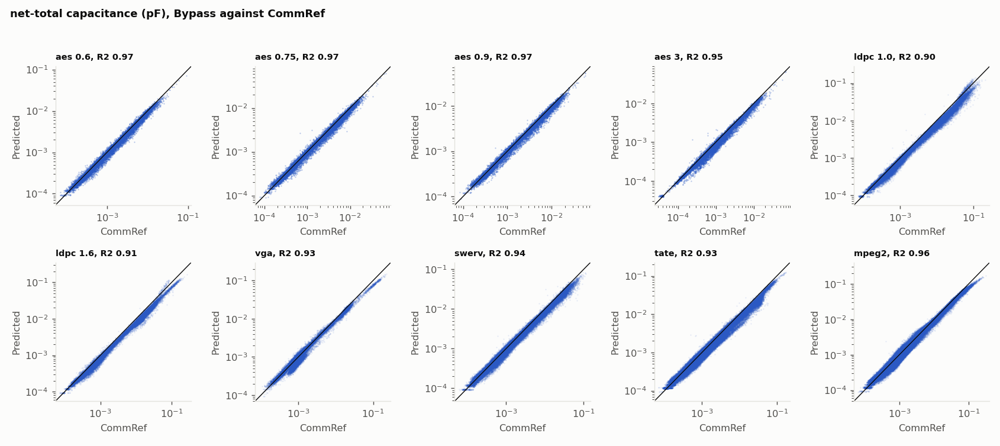

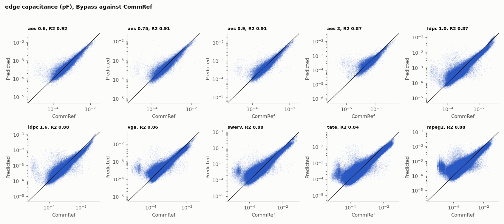

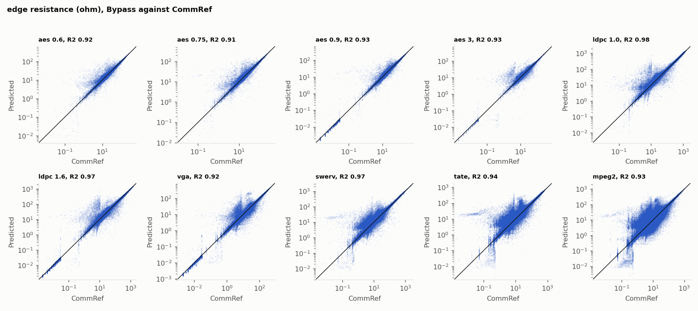

*Edge resistance.* Bypass has the lowest MedAPE and WMAPE on all ten designs (MedAPE 6.2 to 8.2%, against 13.5 to 16.5% for ML and 19.5 to 36.2% for Tech.). Its R² is close to that of ML (0.91 to 0.98 for both, ML higher on six designs) because R² is dominated by the few largest edges, where the methods are close. The difference is in the typical edge. Edge resistance follows from length per layer and vias. The per-layer coefficients and learned correction of Bypass, fitted to the CommRef extraction, capture this better than a single table value per layer with a fixed via resistance (Tech.) or the same features without net topology (ML).

*Edge capacitance.* This target is harder for every method. Bypass has the lowest MedAPE on all ten designs and the lowest WMAPE on nine (MedAPE 11.1 to 20.2%, against 18.3 to 27.2% for ML and 39.5 to 43.5% for Tech.). Extracted segment capacitance also depends on the environment, e.g., local routing density and neighboring layers, which a graph built from the geometry of a single net does not see.

*Net-total capacitance.* Per-edge errors partly cancel when summed over a net, so net totals are more accurate than edge values. Bypass and ML are close. Bypass has the lower MedAPE on seven designs and the lower WMAPE on eight. ML is slightly better in MedAPE on the two `ldpc_decoder_mod` designs and `vga_enh_top`, and in WMAPE on `aes_cipher_top_3_0.92_1.2` and `vga_enh_top`. The WMAPE of Tech. (11.6 to 31.3%) is competitive although its net totals are biased low (mean relative bias of about −19 to −34%). The largest errors of Bypass are on the two `ldpc_decoder_mod` designs (WMAPE 24.2 and 23.4%), where capacitance is underestimated on long nets ([Section 2.2](#22-net-total-capacitance-net-length-and-routing-density)).

*Arc (Elmore) delay.* Bypass has the lowest MedAPE and WMAPE on all ten designs (MedAPE 5.0 to 8.1%, against 11.6 to 23.5% for ML and 16.3 to 34.3% for Tech.) and R² of 0.97 to 0.995. The delay error is smaller than the capacitance error. An Elmore delay is a sum of products of upstream resistance and downstream capacitance, so errors in R and C partly cancel each other along a path.

### 2.2 Net-Total Capacitance, Net Length and Routing Density

Supports the capacitance error analysis of the paper. Source: `model_targets/capacitance_bias_by_length_layer_density.csv`.

- *Weighted bias* is (sum of predicted − sum of CommRef) / sum of CommRef over all nets, in %. A negative value means that the capacitance is underestimated.
- *Bias, 1% longest nets* is the same quantity for the 1% of the nets with the longest routed length.
- *C on 1% longest nets* is the share of the CommRef capacitance of the design that is on those nets.
- *P99 net length* is the routed length below which 99% of the nets of the design lie.

| Design | Weighted bias (%) | Bias, 1% longest nets (%) | C on 1% longest nets (%) | P99 net length (um) |
|:---|---:|---:|---:|---:|
| aes_cipher_top_0.6_0.4_1.0 | −8.0 | −13.6 | 8.1 | 111 |
| aes_cipher_top_0.75_0.4_1.0 | −7.1 | −11.0 | 6.5 | 116 |
| aes_cipher_top_0.9_0.4_1.0 | −8.2 | −13.3 | 6.6 | 131 |
| aes_cipher_top_3_0.92_1.2 | −14.1 | −19.0 | 9.0 | 105 |
| ldpc_decoder_mod_1.0_0.3_1.0 | −22.6 | −20.0 | 12.6 | 461 |
| ldpc_decoder_mod_1.6_0.4_1.0 | −22.5 | −26.1 | 15.8 | 554 |
| vga_enh_top_1.0_0.6_1.0 | −14.2 | −26.0 | 28.4 | 712 |
| swerv_wrapper_1.0_0.7_1.0 | −12.9 | −24.8 | 12.5 | 385 |
| tate_pairing_1.0_0.6_1.0 | −16.2 | −20.0 | 21.1 | 270 |
| mpeg2_top_1.0_0.6_1.0 | −8.2 | −17.2 | 24.0 | 501 |
| validation (6 runs) | −3.4 | −9.0 |  |  |

- *Bypass underestimates the capacitance of every test design*, by 7.1 to 22.6% in total, against 3.4% on the validation runs.
- *The bias grows with net length.* On `mpeg2_top`, `vga_enh_top`, `swerv_wrapper` and `tate_pairing` it is −1 to −9% below 20 um and reaches −17 to −29% in the longest bins (above 200 um). `aes_cipher_top_3_0.92_1.2` and the two `ldpc_decoder_mod` designs are already 11 to 16% low on nets below 10 um and get worse with length. For the 1% longest nets the bias is −11.0 to −26.1% on the test designs and −6.8 to −12.1% on the validation runs. These nets carry 6.5 to 28.4% of a design's capacitance, so their underestimate lowers the total.
- *The test designs exceed the training range.* P99 net length is 104 to 229 um on the validation runs and up to 712 um on the test designs. A log-space loss makes the model accurate for the typical short net and less accurate for the rare long ones.

---

## 3. STA Analysis

### 3.1 Setup

The CommRef SPEF of each test design is the reference. The SPEFs of Tech., ML, Bypass and Ceiling are evaluated in the same way in PrimeTime and OpenSTA and compared with it.

### 3.2 Interconnect (Arc) Delay

The arc-delay MedAPE table is in [Section 1.4](#14-interconnect-arc-delay-table-ii).

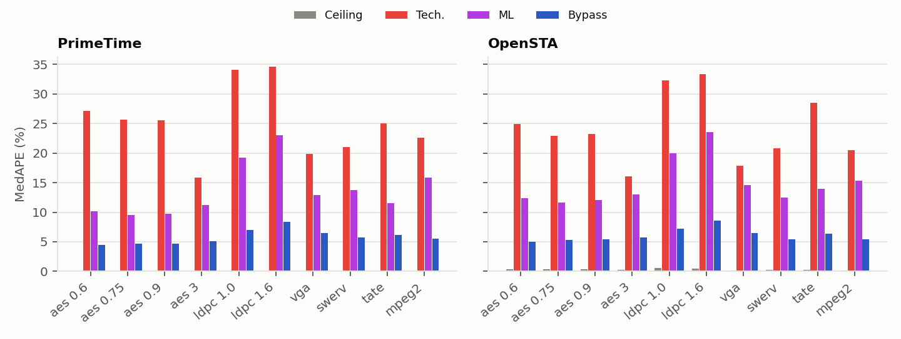

The scatter plots show the Bypass delay of every arc against the CommRef delay of the same arc, for each design, with the diagonal as reference. Every arc with a delay above 0 in both runs is one point, with no cut of the axes (the title gives R² and the number of arcs). Darker areas are where points overlap.

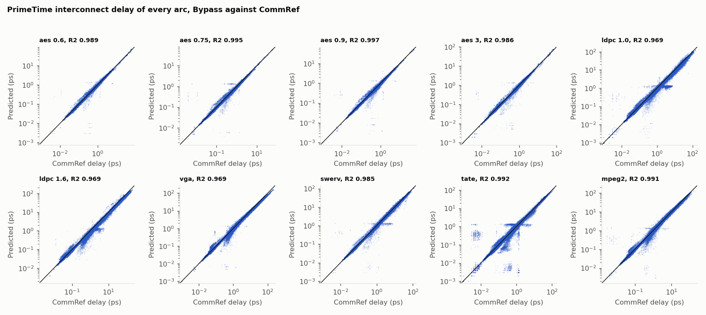

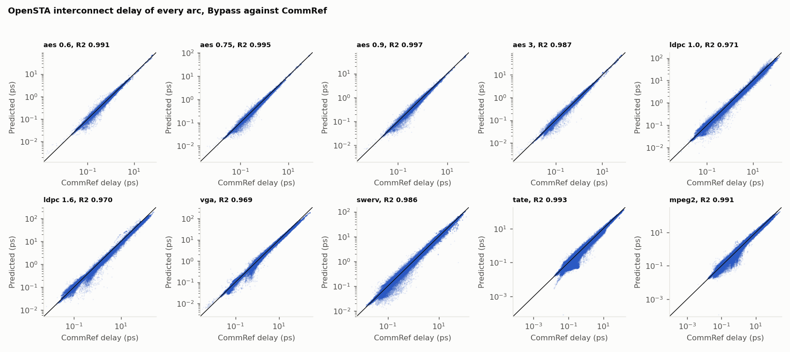

- Bypass follows the diagonal on all ten designs (R² 0.969 to 0.997 in PrimeTime and OpenSTA). The scatter around the diagonal is widest for CommRef delays under 1 ps, for example on `tate_pairing`.
- For CommRef delays below 0.1 ps, the median error of Bypass is −2.4 to +1.8% in PrimeTime and −1.9 to +1.2% in OpenSTA. For Tech. it is −50.3 to −23.8% and −53.2 to −27.7%, and for ML −19.0 to +0.9% and −21.2 to −4.0%. Tech. underestimates the small delays, which are most of the arcs.
- For CommRef delays of 10 ps and above, the median error of Bypass is −12.1 to +5.2% in PrimeTime and −12.0 to +5.0% in OpenSTA.
- The 5 to 95% band of Bypass is 26 to 46 percentage points wide below 0.1 ps and 11 to 39 above 10 ps in PrimeTime.

### 3.3 Endpoint Arrival Time

The median absolute error in PrimeTime is in [Section 1.5](#15-endpoint-arrival-time-table-iii). This section adds the signed error in both tools.

Signed median endpoint error of Bypass (ps).

| Design | PrimeTime | OpenSTA |
|:---|---:|---:|
| aes_cipher_top_0.6_0.4_1.0 | −4.9 | −4.6 |
| aes_cipher_top_0.75_0.4_1.0 | −4.9 | −4.4 |
| aes_cipher_top_0.9_0.4_1.0 | −9.4 | −7.7 |
| aes_cipher_top_3_0.92_1.2 | −12.6 | −6.1 |
| ldpc_decoder_mod_1.0_0.3_1.0 | −59.8 | −50.8 |
| ldpc_decoder_mod_1.6_0.4_1.0 | −97.2 | −61.7 |
| vga_enh_top_1.0_0.6_1.0 | −30.3 | −30.0 |
| swerv_wrapper_1.0_0.7_1.0 | −45.9 | −44.5 |
| tate_pairing_1.0_0.6_1.0 | −39.5 | −42.2 |
| mpeg2_top_1.0_0.6_1.0 | −65.1 | −54.4 |

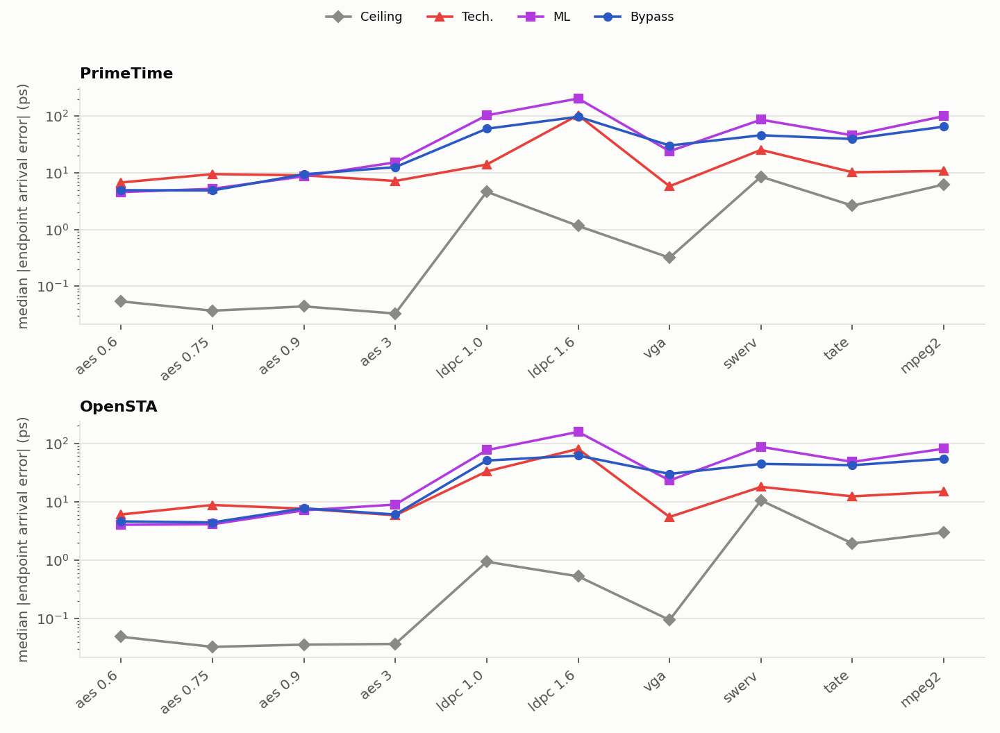

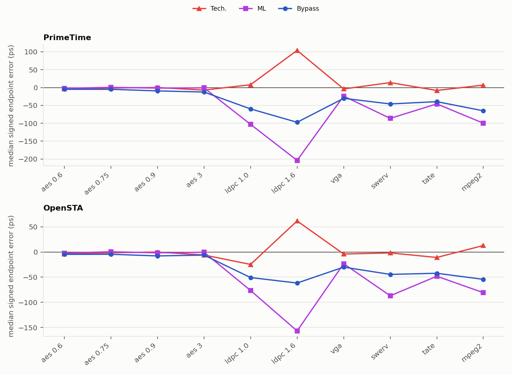

- *Bypass is early on every design.* Its signed median error is negative on all ten designs, in both tools. The cause is the underestimated net capacitance ([Section 3.6](#36-component-ablation)).
- *The error is small where the capacitance bias is small.* It is 4.9 to 12.6 ps on the four `aes_cipher_top` designs, and larger on designs whose nets are longer and denser than in training ([Section 2.2](#22-net-total-capacitance-net-length-and-routing-density)).
- *Tech. has a smaller median than Bypass on seven of ten designs.* It overestimates some nets and underestimates others, and these errors cancel over a typical path. The cost appears in the tail and in the worst slack: on `aes_cipher_top_0.9_0.4_1.0`, Tech. has a median of 9.0 ps, but 1% of endpoints exceed 159 ps and its ΔWNS is −210.0 ps.
- *Calibration reduces the error on all ten designs* (mean 37.0 to 17.3 ps).

### 1.6 Worst Slack (Table IV)

ΔWNS (ps), PrimeTime. A positive value means the predicted worst slack is larger (optimistic) than CommRef.

| Design | Tech. | ML | Bypass | Bypass Cal. |
|:---|---:|---:|---:|---:|
| aes_cipher_top_0.6_0.4_1.0 | −15.9 | +8.6 | +5.7 | −0.6 |
| aes_cipher_top_0.75_0.4_1.0 | −88.5 | −5.2 | +2.8 | −5.3 |
| aes_cipher_top_0.9_0.4_1.0 | −210.0 | −4.9 | +4.6 | −10.1 |
| aes_cipher_top_3_0.92_1.2 | +68.4 | +46.8 | +59.5 | +39.0 |
| ldpc_decoder_mod_1.0_0.3_1.0 | −55.4 | +84.1 | +3.2 | −29.9 |
| ldpc_decoder_mod_1.6_0.4_1.0 | −200.4 | +170.2 | +73.6 | −13.5 |
| vga_enh_top_1.0_0.6_1.0 | −150.8 | −17.5 | −0.5 | −13.8 |
| swerv_wrapper_1.0_0.7_1.0 | −149.3 | +146.4 | +99.2 | +48.9 |
| tate_pairing_1.0_0.6_1.0 | −187.8 | −21.1 | +19.2 | +5.3 |
| mpeg2_top_1.0_0.6_1.0 | −242.4 | +3.7 | −29.6 | −40.1 |
| Mean \|ΔWNS\| | 136.9 | 50.9 | 29.8 | 20.7 |

- *Bypass has the smallest \|ΔWNS\| on eight of ten designs.* It is within 6 ps on five designs.
- *Tech. is pessimistic* on nine of ten designs, up to −242.4 ps, because the longest nets, which dominate the critical path, are overestimated. *ML can be strongly optimistic*, up to +170.2 ps.
- *ΔWNS is a single path*, so it does not follow the median endpoint error. For Tech., \|ΔWNS\| exceeds the median endpoint error on all ten designs.
- *Calibration improves ΔWNS on average and in the worst case, but not on every design.* The maximum goes from 99.2 to 48.9 ps. \|ΔWNS\| increases on five designs, on all of which the uncalibrated \|ΔWNS\| was already 29.6 ps or less ([Section 4.3](#43-effect-on-timing-primetime)).
- ΔWNS in OpenSTA is in [Section 3.4](#34-worst-slack).

---

## 2. Model Targets

### 2.1 Accuracy of the Predicted R and C

Per-design values behind Table I. Metrics are defined in [Section 1.2](#12-metrics). Source: `model_targets/target_accuracy_per_design.csv`.

*Edge resistance*

| Design | MedAPE, Tech. | MedAPE, ML | MedAPE, Bypass | WMAPE, Tech. | WMAPE, ML | WMAPE, Bypass | R², Tech. | R², ML | R², Bypass |
|:---|---:|---:|---:|---:|---:|---:|---:|---:|---:|
| aes_cipher_top_0.6_0.4_1.0 | 32.1 | 14.2 | 6.2 | 28.8 | 15.4 | 10.4 | 0.79 | 0.92 | 0.92 |
| aes_cipher_top_0.75_0.4_1.0 | 30.3 | 14.1 | 6.6 | 27.2 | 15.3 | 11.5 | 0.82 | 0.92 | 0.91 |
| aes_cipher_top_0.9_0.4_1.0 | 31.2 | 15.3 | 6.3 | 28.0 | 17.2 | 9.7 | 0.83 | 0.92 | 0.93 |
| aes_cipher_top_3_0.92_1.2 | 19.5 | 14.8 | 6.3 | 21.4 | 18.5 | 11.0 | 0.90 | 0.91 | 0.93 |
| ldpc_decoder_mod_1.0_0.3_1.0 | 35.7 | 13.5 | 6.5 | 22.0 | 11.9 | 9.7 | 0.96 | 0.98 | 0.98 |
| ldpc_decoder_mod_1.6_0.4_1.0 | 36.2 | 15.1 | 6.3 | 25.2 | 15.3 | 9.3 | 0.94 | 0.96 | 0.97 |
| vga_enh_top_1.0_0.6_1.0 | 26.3 | 16.5 | 7.3 | 24.4 | 18.7 | 11.3 | 0.91 | 0.93 | 0.92 |
| swerv_wrapper_1.0_0.7_1.0 | 32.6 | 14.6 | 6.9 | 24.6 | 14.3 | 10.8 | 0.96 | 0.98 | 0.97 |
| tate_pairing_1.0_0.6_1.0 | 35.3 | 15.6 | 8.2 | 27.0 | 16.2 | 14.4 | 0.93 | 0.96 | 0.94 |
| mpeg2_top_1.0_0.6_1.0 | 28.4 | 15.6 | 7.7 | 25.6 | 16.6 | 13.1 | 0.91 | 0.94 | 0.93 |

*Edge capacitance*

| Design | MedAPE, Tech. | MedAPE, ML | MedAPE, Bypass | WMAPE, Tech. | WMAPE, ML | WMAPE, Bypass | R², Tech. | R², ML | R², Bypass |
|:---|---:|---:|---:|---:|---:|---:|---:|---:|---:|
| aes_cipher_top_0.6_0.4_1.0 | 41.8 | 18.5 | 11.1 | 40.6 | 22.6 | 16.7 | −0.04 | 0.92 | 0.92 |
| aes_cipher_top_0.75_0.4_1.0 | 41.5 | 20.3 | 11.7 | 39.7 | 23.3 | 17.3 | 0.30 | 0.90 | 0.91 |
| aes_cipher_top_0.9_0.4_1.0 | 42.6 | 21.0 | 12.1 | 43.6 | 24.1 | 18.3 | −0.12 | 0.90 | 0.91 |
| aes_cipher_top_3_0.92_1.2 | 42.1 | 21.9 | 17.3 | 38.7 | 26.5 | 23.9 | 0.86 | 0.91 | 0.87 |
| ldpc_decoder_mod_1.0_0.3_1.0 | 40.0 | 24.2 | 17.9 | 35.1 | 35.2 | 28.8 | 0.79 | 0.80 | 0.87 |
| ldpc_decoder_mod_1.6_0.4_1.0 | 42.2 | 27.2 | 20.2 | 41.0 | 35.1 | 28.8 | 0.66 | 0.83 | 0.88 |
| vga_enh_top_1.0_0.6_1.0 | 39.5 | 18.3 | 16.9 | 33.3 | 25.0 | 25.0 | 0.71 | 0.90 | 0.86 |
| swerv_wrapper_1.0_0.7_1.0 | 42.7 | 21.6 | 13.3 | 37.0 | 26.9 | 22.7 | 0.56 | 0.90 | 0.88 |
| tate_pairing_1.0_0.6_1.0 | 43.5 | 22.4 | 16.4 | 34.4 | 29.2 | 26.8 | 0.57 | 0.88 | 0.84 |
| mpeg2_top_1.0_0.6_1.0 | 40.6 | 19.5 | 14.1 | 36.9 | 27.8 | 21.9 | 0.53 | 0.86 | 0.88 |

*Net-total capacitance*

| Design | MedAPE, Tech. | MedAPE, ML | MedAPE, Bypass | WMAPE, Tech. | WMAPE, ML | WMAPE, Bypass | R², Tech. | R², ML | R², Bypass |
|:---|---:|---:|---:|---:|---:|---:|---:|---:|---:|
| aes_cipher_top_0.6_0.4_1.0 | 30.4 | 9.2 | 8.2 | 28.1 | 13.1 | 10.4 | 0.66 | 0.96 | 0.97 |
| aes_cipher_top_0.75_0.4_1.0 | 27.3 | 9.2 | 7.6 | 24.7 | 12.4 | 10.1 | 0.77 | 0.96 | 0.97 |
| aes_cipher_top_0.9_0.4_1.0 | 27.9 | 8.9 | 7.6 | 27.6 | 12.4 | 10.6 | 0.65 | 0.96 | 0.97 |
| aes_cipher_top_3_0.92_1.2 | 33.2 | 10.9 | 9.8 | 27.6 | 12.2 | 14.6 | 0.91 | 0.97 | 0.95 |
| ldpc_decoder_mod_1.0_0.3_1.0 | 32.2 | 14.8 | 15.0 | 29.6 | 32.6 | 24.2 | 0.85 | 0.80 | 0.90 |
| ldpc_decoder_mod_1.6_0.4_1.0 | 34.0 | 15.5 | 17.0 | 31.3 | 31.5 | 23.4 | 0.87 | 0.83 | 0.91 |
| vga_enh_top_1.0_0.6_1.0 | 20.5 | 8.2 | 8.8 | 11.6 | 14.8 | 16.5 | 0.98 | 0.95 | 0.93 |
| swerv_wrapper_1.0_0.7_1.0 | 29.1 | 11.1 | 8.6 | 24.6 | 20.2 | 15.9 | 0.80 | 0.92 | 0.94 |
| tate_pairing_1.0_0.6_1.0 | 26.6 | 9.9 | 9.6 | 19.7 | 20.2 | 18.9 | 0.85 | 0.90 | 0.93 |
| mpeg2_top_1.0_0.6_1.0 | 21.7 | 8.7 | 8.1 | 14.8 | 18.5 | 11.9 | 0.96 | 0.91 | 0.96 |

*Arc (Elmore) delay*

| Design | MedAPE, Tech. | MedAPE, ML | MedAPE, Bypass | WMAPE, Tech. | WMAPE, ML | WMAPE, Bypass | R², Tech. | R², ML | R², Bypass |
|:---|---:|---:|---:|---:|---:|---:|---:|---:|---:|
| aes_cipher_top_0.6_0.4_1.0 | 25.0 | 12.4 | 5.0 | 16.2 | 15.1 | 6.8 | 0.97 | 0.95 | 0.99 |
| aes_cipher_top_0.75_0.4_1.0 | 23.1 | 11.6 | 5.3 | 17.4 | 17.5 | 6.8 | 0.93 | 0.90 | 1.00 |
| aes_cipher_top_0.9_0.4_1.0 | 23.3 | 12.1 | 5.4 | 19.3 | 14.6 | 7.1 | 0.92 | 0.94 | 0.99 |
| aes_cipher_top_3_0.92_1.2 | 16.3 | 12.7 | 5.6 | 11.5 | 16.5 | 8.0 | 0.98 | 0.95 | 0.99 |
| ldpc_decoder_mod_1.0_0.3_1.0 | 32.9 | 20.1 | 6.9 | 21.5 | 23.7 | 12.6 | 0.95 | 0.92 | 0.97 |
| ldpc_decoder_mod_1.6_0.4_1.0 | 34.3 | 23.5 | 8.1 | 23.9 | 27.1 | 13.8 | 0.93 | 0.90 | 0.97 |
| vga_enh_top_1.0_0.6_1.0 | 18.0 | 14.5 | 6.4 | 10.9 | 15.1 | 10.7 | 0.99 | 0.97 | 0.97 |
| swerv_wrapper_1.0_0.7_1.0 | 21.0 | 12.3 | 5.3 | 14.7 | 15.7 | 6.9 | 0.96 | 0.95 | 0.99 |
| tate_pairing_1.0_0.6_1.0 | 25.1 | 13.5 | 6.5 | 12.3 | 13.9 | 7.0 | 0.98 | 0.97 | 0.99 |
| mpeg2_top_1.0_0.6_1.0 | 20.4 | 15.3 | 5.4 | 16.8 | 17.7 | 6.0 | 0.96 | 0.95 | 0.99 |

#### Plots


The next three figures show Bypass against CommRef for every edge or net of each design, with the diagonal as reference. The title of each plot shows the R² of the table of [Section 2](#2-model-targets). 


*Edge resistance.* Bypass has the lowest MedAPE and WMAPE on all ten designs (MedAPE 6.2 to 8.2%, against 13.5 to 16.5% for ML and 19.5 to 36.2% for Tech.). Its R² is close to that of ML (0.91 to 0.98 for both, ML higher on six designs) because R² is dominated by the few largest edges, where the methods are close. The difference is in the typical edge. Edge resistance follows from length per layer and vias. The per-layer coefficients and learned correction of Bypass, fitted to the CommRef extraction, capture this better than a single table value per layer with a fixed via resistance (Tech.) or the same features without net topology (ML).

*Edge capacitance.* This target is harder for every method. Bypass has the lowest MedAPE on all ten designs and the lowest WMAPE on nine (MedAPE 11.1 to 20.2%, against 18.3 to 27.2% for ML and 39.5 to 43.5% for Tech.). Extracted segment capacitance also depends on the environment, e.g., local routing density and neighboring layers, which a graph built from the geometry of a single net does not see.

*Net-total capacitance.* Per-edge errors partly cancel when summed over a net, so net totals are more accurate than edge values. Bypass and ML are close. Bypass has the lower MedAPE on seven designs and the lower WMAPE on eight. ML is slightly better in MedAPE on the two `ldpc_decoder_mod` designs and `vga_enh_top`, and in WMAPE on `aes_cipher_top_3_0.92_1.2` and `vga_enh_top`. The WMAPE of Tech. (11.6 to 31.3%) is competitive although its net totals are biased low (mean relative bias of about −19 to −34%). The largest errors of Bypass are on the two `ldpc_decoder_mod` designs (WMAPE 24.2 and 23.4%), where capacitance is underestimated on long nets ([Section 2.2](#22-net-total-capacitance-net-length-and-routing-density)).

*Arc (Elmore) delay.* Bypass has the lowest MedAPE and WMAPE on all ten designs (MedAPE 5.0 to 8.1%, against 11.6 to 23.5% for ML and 16.3 to 34.3% for Tech.) and R² of 0.97 to 0.995. The delay error is smaller than the capacitance error. An Elmore delay is a sum of products of upstream resistance and downstream capacitance, so errors in R and C partly cancel each other along a path.

### 2.2 Net-Total Capacitance, Net Length and Routing Density

Supports the capacitance error analysis of the paper. Source: `model_targets/capacitance_bias_by_length_layer_density.csv`.

- *Weighted bias* is (sum of predicted − sum of CommRef) / sum of CommRef over all nets, in %. A negative value means that the capacitance is underestimated.
- *Bias, 1% longest nets* is the same quantity for the 1% of the nets with the longest routed length.
- *C on 1% longest nets* is the share of the CommRef capacitance of the design that is on those nets.
- *P99 net length* is the routed length below which 99% of the nets of the design lie.

| Design | Weighted bias (%) | Bias, 1% longest nets (%) | C on 1% longest nets (%) | P99 net length (um) |
|:---|---:|---:|---:|---:|
| aes_cipher_top_0.6_0.4_1.0 | −8.0 | −13.6 | 8.1 | 111 |
| aes_cipher_top_0.75_0.4_1.0 | −7.1 | −11.0 | 6.5 | 116 |
| aes_cipher_top_0.9_0.4_1.0 | −8.2 | −13.3 | 6.6 | 131 |
| aes_cipher_top_3_0.92_1.2 | −14.1 | −19.0 | 9.0 | 105 |
| ldpc_decoder_mod_1.0_0.3_1.0 | −22.6 | −20.0 | 12.6 | 461 |
| ldpc_decoder_mod_1.6_0.4_1.0 | −22.5 | −26.1 | 15.8 | 554 |
| vga_enh_top_1.0_0.6_1.0 | −14.2 | −26.0 | 28.4 | 712 |
| swerv_wrapper_1.0_0.7_1.0 | −12.9 | −24.8 | 12.5 | 385 |
| tate_pairing_1.0_0.6_1.0 | −16.2 | −20.0 | 21.1 | 270 |
| mpeg2_top_1.0_0.6_1.0 | −8.2 | −17.2 | 24.0 | 501 |
| validation (6 runs) | −3.4 | −9.0 |  |  |

- *Bypass underestimates the capacitance of every test design*, by 7.1 to 22.6% in total, against 3.4% on the validation runs.
- *The bias grows with net length.* On `mpeg2_top`, `vga_enh_top`, `swerv_wrapper` and `tate_pairing` it is −1 to −9% below 20 um and reaches −17 to −29% in the longest bins (above 200 um). `aes_cipher_top_3_0.92_1.2` and the two `ldpc_decoder_mod` designs are already 11 to 16% low on nets below 10 um and get worse with length. For the 1% longest nets the bias is −11.0 to −26.1% on the test designs and −6.8 to −12.1% on the validation runs. These nets carry 6.5 to 28.4% of a design's capacitance, so their underestimate lowers the total.
- *The test designs exceed the training range.* P99 net length is 104 to 229 um on the validation runs and up to 712 um on the test designs. A log-space loss makes the model accurate for the typical short net and less accurate for the rare long ones.

---

## 3. STA Analysis

### 3.1 Setup

The CommRef SPEF of each test design is the reference. The SPEFs of Tech., ML, Bypass and Ceiling are evaluated in the same way in PrimeTime and OpenSTA and compared with it.

### 3.2 Interconnect (Arc) Delay

The arc-delay MedAPE table is in [Section 1.4](#14-interconnect-arc-delay-table-ii).


The scatter plots show the Bypass delay of every arc against the CommRef delay of the same arc, for each design, with the diagonal as reference. Every arc with a delay above 0 in both runs is one point, with no cut of the axes (the title gives R² and the number of arcs). Darker areas are where points overlap.


- Bypass follows the diagonal on all ten designs (R² 0.969 to 0.997 in PrimeTime and OpenSTA). The scatter around the diagonal is widest for CommRef delays under 1 ps, for example on `tate_pairing`.
- For CommRef delays below 0.1 ps, the median error of Bypass is −2.4 to +1.8% in PrimeTime and −1.9 to +1.2% in OpenSTA. For Tech. it is −50.3 to −23.8% and −53.2 to −27.7%, and for ML −19.0 to +0.9% and −21.2 to −4.0%. Tech. underestimates the small delays, which are most of the arcs.
- For CommRef delays of 10 ps and above, the median error of Bypass is −12.1 to +5.2% in PrimeTime and −12.0 to +5.0% in OpenSTA.
- The 5 to 95% band of Bypass is 26 to 46 percentage points wide below 0.1 ps and 11 to 39 above 10 ps in PrimeTime.

### 3.3 Endpoint Arrival Time

The median absolute error in PrimeTime is in [Section 1.5](#15-endpoint-arrival-time-table-iii). This section adds the signed error in both tools.

Signed median endpoint error of Bypass (ps).

| Design | PrimeTime | OpenSTA |
|:---|---:|---:|
| aes_cipher_top_0.6_0.4_1.0 | −4.9 | −4.6 |
| aes_cipher_top_0.75_0.4_1.0 | −4.9 | −4.4 |
| aes_cipher_top_0.9_0.4_1.0 | −9.4 | −7.7 |
| aes_cipher_top_3_0.92_1.2 | −12.6 | −6.1 |
| ldpc_decoder_mod_1.0_0.3_1.0 | −59.8 | −50.8 |
| ldpc_decoder_mod_1.6_0.4_1.0 | −97.2 | −61.7 |
| vga_enh_top_1.0_0.6_1.0 | −30.3 | −30.0 |
| swerv_wrapper_1.0_0.7_1.0 | −45.9 | −44.5 |
| tate_pairing_1.0_0.6_1.0 | −39.5 | −42.2 |
| mpeg2_top_1.0_0.6_1.0 | −65.1 | −54.4 |


- *Bypass is early on every design.* Its signed median error is negative on all ten designs (−4.9 to −97.2 ps in PrimeTime, −4.4 to −61.7 ps in OpenSTA). The underestimated capacitance ([Section 2.2](#22-net-total-capacitance-net-length-and-routing-density)) shortens every stage delay on a path in the same direction, so the errors add up along the path.
- *The error is small where the capacitance bias is small.* On the four `aes_cipher_top` designs the median is 4.9 to 12.6 ps. On `ldpc_decoder_mod`, `mpeg2_top`, `swerv_wrapper` and `tate_pairing` it is 39.5 to 97.2 ps.
- *ML is worse than Bypass on the dense designs.* Its median error is 86.2 to 203.8 ps on `ldpc_decoder_mod`, `mpeg2_top` and `swerv_wrapper` (Bypass 45.9 to 97.2 ps). A per-edge regressor does not extrapolate to long, high-capacitance nets.
- *Tech. has a smaller median than Bypass on seven of ten designs.* Its errors cancel over the typical endpoint, and its signed median varies in sign (−8.2 to +103.9 ps in PrimeTime). The cost shows in the worst slack ([Section 3.4](#34-worst-slack)).
- *The Ceiling is at 0.03 to 8.5 ps*, which is the floor set by the representation.

### 3.4 Worst Slack

ΔWNS (ps) in both tools. The PrimeTime columns are those of Table IV ([Section 1.6](#16-worst-slack-table-iv)).

| Design | Tech. (PT) | ML (PT) | Bypass (PT) | Tech. (OpenSTA) | ML (OpenSTA) | Bypass (OpenSTA) |
|:---|---:|---:|---:|---:|---:|---:|
| aes_cipher_top_0.6_0.4_1.0 | −15.9 | +8.6 | +5.7 | −20.9 | +8.0 | +5.7 |
| aes_cipher_top_0.75_0.4_1.0 | −88.5 | −5.2 | +2.8 | −90.6 | −6.4 | +2.0 |
| aes_cipher_top_0.9_0.4_1.0 | −210.0 | −4.9 | +4.6 | −207.2 | −9.3 | +4.4 |
| aes_cipher_top_3_0.92_1.2 | +68.4 | +46.8 | +59.5 | +64.8 | +43.5 | +56.5 |
| ldpc_decoder_mod_1.0_0.3_1.0 | −55.4 | +84.1 | +3.2 | −73.9 | +60.1 | −6.5 |
| ldpc_decoder_mod_1.6_0.4_1.0 | −200.4 | +170.2 | +73.6 | −212.2 | +185.8 | +83.8 |
| vga_enh_top_1.0_0.6_1.0 | −150.8 | −17.5 | −0.5 | −147.7 | −14.2 | +2.0 |
| swerv_wrapper_1.0_0.7_1.0 | −149.3 | +146.4 | +99.2 | −168.4 | +18.1 | +4.6 |
| tate_pairing_1.0_0.6_1.0 | −187.8 | −21.1 | +19.2 | −172.1 | −15.7 | +20.1 |
| mpeg2_top_1.0_0.6_1.0 | −242.4 | +3.7 | −29.6 | −227.1 | +2.7 | −19.0 |

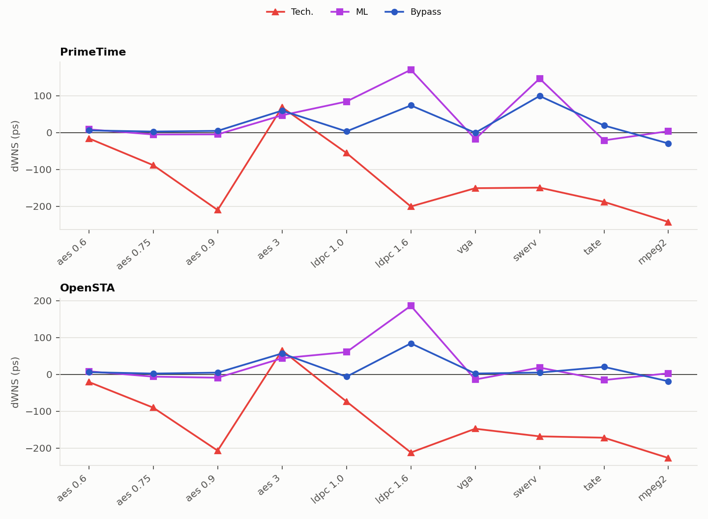

- *The two tools agree for Bypass within 11 ps on nine designs.* The exception is `swerv_wrapper` (+99.2 ps in PrimeTime, +4.6 ps in OpenSTA).
- *Tech. is pessimistic in both tools* on nine of ten designs.
- *For Bypass, \|ΔWNS\| is smaller than the median endpoint error on seven designs*, because the worst path is not a typical path.

### 3.5 Slack Error Decomposition

This analysis is not included in the paper. Slack at a flip-flop endpoint is the capture-clock arrival minus the data arrival. With errors defined as predicted minus CommRef, slack error = clock error − data error. Bypass also underestimates the capacitance of the clock nets.

| Design | Weighted bias, clock nets (%) | Weighted bias, all nets (%) |
|:---|---:|---:|
| aes_cipher_top_0.6_0.4_1.0 | −13.7 | −8.0 |
| aes_cipher_top_0.75_0.4_1.0 | −12.9 | −7.1 |
| aes_cipher_top_0.9_0.4_1.0 | −13.0 | −8.2 |
| aes_cipher_top_3_0.92_1.2 | −14.8 | −14.1 |
| ldpc_decoder_mod_1.0_0.3_1.0 | −16.2 | −22.6 |
| ldpc_decoder_mod_1.6_0.4_1.0 | −16.9 | −22.5 |
| vga_enh_top_1.0_0.6_1.0 | −14.5 | −14.2 |
| swerv_wrapper_1.0_0.7_1.0 | −12.6 | −12.9 |
| tate_pairing_1.0_0.6_1.0 | −13.0 | −16.2 |
| mpeg2_top_1.0_0.6_1.0 | −6.1 | −8.2 |

*Clock nets* are the nets connected to the clock pins of flip-flops. The two bias columns use the weighted bias of [Section 2.2](#22-net-total-capacitance-net-length-and-routing-density), for the clock nets and for all nets.

Because the clock nets are also underestimated, the capture clock arrives too early as well, and this cancels part of the early data arrival.

### 3.6 Component Ablation

Extends the replacement experiment of the paper, which reports three designs, to all ten designs in both tools. The Ceiling SPEF is taken and one quantity is replaced by that of Bypass: the net capacitance (real R, Bypass C) or the resistance (real C, Bypass R). The evaluation scripts build the two SPEF variants and the tables, and `scripts/opensta_scripts/run_opensta_ablation.sh` and `scripts/pt_scripts/run_primetime_ablation.sh` time all five variants.

Errors are predicted minus CommRef, in ps. The CSV files `sta_analysis/component_ablation_primetime.csv` and `sta_analysis/component_ablation_opensta.csv` also have the bias and the share of early endpoints.

#### PrimeTime

Median endpoint error (ps)

| Design | Ceiling | Bypass | real R, Bypass C | real C, Bypass R |
|:---|---:|---:|---:|---:|
| aes_cipher_top_0.6_0.4_1.0 | 0.0 | −4.9 | −6.1 | 0.0 |
| aes_cipher_top_0.75_0.4_1.0 | 0.0 | −4.9 | −6.2 | +0.1 |
| aes_cipher_top_0.9_0.4_1.0 | 0.0 | −9.4 | −11.0 | +0.8 |
| aes_cipher_top_3_0.92_1.2 | 0.0 | −12.6 | −15.6 | +0.3 |
| ldpc_decoder_mod_1.0_0.3_1.0 | +4.6 | −59.8 | −61.5 | +11.4 |
| ldpc_decoder_mod_1.6_0.4_1.0 | +1.1 | −97.2 | −104.1 | +18.5 |
| vga_enh_top_1.0_0.6_1.0 | +0.3 | −30.3 | −32.1 | +1.6 |
| swerv_wrapper_1.0_0.7_1.0 | +8.5 | −45.9 | −54.0 | +17.2 |
| tate_pairing_1.0_0.6_1.0 | +2.6 | −39.5 | −35.6 | +1.0 |
| mpeg2_top_1.0_0.6_1.0 | −6.2 | −65.1 | −68.0 | −2.7 |
| Mean over the ten designs | +1.1 | −37.0 | −39.4 | +4.8 |

ΔWNS (ps)

| Design | Ceiling | Bypass | real R, Bypass C | real C, Bypass R |
|:---|---:|---:|---:|---:|
| aes_cipher_top_0.6_0.4_1.0 | −0.4 | +5.7 | +6.3 | −0.5 |
| aes_cipher_top_0.75_0.4_1.0 | 0.0 | +2.8 | +3.0 | −0.2 |
| aes_cipher_top_0.9_0.4_1.0 | 0.0 | +4.6 | +5.1 | −0.4 |
| aes_cipher_top_3_0.92_1.2 | −0.3 | +59.5 | +60.0 | +0.1 |
| ldpc_decoder_mod_1.0_0.3_1.0 | −16.0 | +3.2 | +17.8 | −17.4 |
| ldpc_decoder_mod_1.6_0.4_1.0 | −1.7 | +73.6 | +68.1 | −23.4 |
| vga_enh_top_1.0_0.6_1.0 | +0.3 | −0.5 | −1.7 | −3.3 |
| swerv_wrapper_1.0_0.7_1.0 | −9.3 | +99.2 | +107.9 | −18.5 |
| tate_pairing_1.0_0.6_1.0 | −3.1 | +19.2 | +21.0 | −5.9 |
| mpeg2_top_1.0_0.6_1.0 | +0.3 | −29.6 | −25.8 | +0.1 |

#### OpenSTA

Median endpoint error (ps)

| Design | Ceiling | Bypass | real R, Bypass C | real C, Bypass R |
|:---|---:|---:|---:|---:|
| aes_cipher_top_0.6_0.4_1.0 | 0.0 | −4.7 | −5.7 | +0.1 |
| aes_cipher_top_0.75_0.4_1.0 | 0.0 | −4.4 | −5.9 | +0.2 |
| aes_cipher_top_0.9_0.4_1.0 | 0.0 | −7.8 | −9.9 | +0.9 |
| aes_cipher_top_3_0.92_1.2 | 0.0 | −6.1 | −7.5 | +0.3 |
| ldpc_decoder_mod_1.0_0.3_1.0 | +0.2 | −50.8 | −51.2 | +2.6 |
| ldpc_decoder_mod_1.6_0.4_1.0 | 0.0 | −61.7 | −64.5 | +1.8 |
| vga_enh_top_1.0_0.6_1.0 | +0.1 | −30.0 | −32.1 | +1.8 |
| swerv_wrapper_1.0_0.7_1.0 | +10.5 | −44.5 | −52.3 | +19.2 |
| tate_pairing_1.0_0.6_1.0 | +1.9 | −42.2 | −37.1 | −1.9 |
| mpeg2_top_1.0_0.6_1.0 | −3.0 | −54.4 | −58.0 | +0.6 |
| Mean over the ten designs | +1.0 | −30.6 | −32.4 | +2.5 |

ΔWNS (ps)

| Design | Ceiling | Bypass | real R, Bypass C | real C, Bypass R |
|:---|---:|---:|---:|---:|
| aes_cipher_top_0.6_0.4_1.0 | −0.3 | +5.7 | +6.1 | −0.5 |
| aes_cipher_top_0.75_0.4_1.0 | −0.4 | +2.0 | +2.0 | −0.3 |
| aes_cipher_top_0.9_0.4_1.0 | −0.1 | +4.4 | +4.2 | −0.2 |
| aes_cipher_top_3_0.92_1.2 | −0.5 | +56.5 | +56.4 | −0.9 |
| ldpc_decoder_mod_1.0_0.3_1.0 | −13.8 | −6.5 | +6.8 | −15.0 |
| ldpc_decoder_mod_1.6_0.4_1.0 | −2.5 | +83.8 | +91.9 | −28.5 |
| vga_enh_top_1.0_0.6_1.0 | −0.8 | +2.0 | +1.3 | −2.5 |
| swerv_wrapper_1.0_0.7_1.0 | −0.4 | +4.6 | −22.9 | −1.0 |
| tate_pairing_1.0_0.6_1.0 | −0.7 | +20.1 | +20.7 | −0.2 |
| mpeg2_top_1.0_0.6_1.0 | 0.0 | −19.0 | −16.7 | +0.1 |

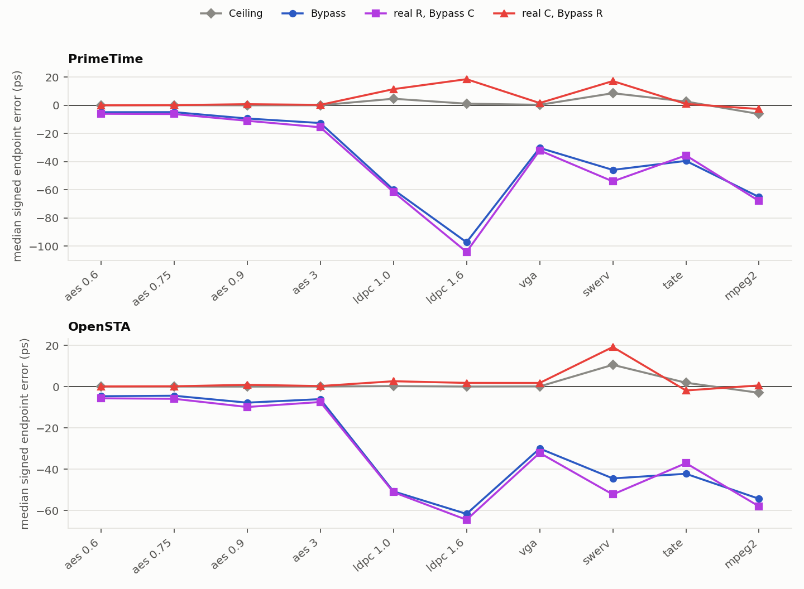

- Real R with Bypass C reproduces the error of Bypass on every design in both tools (within 8.2 ps, e.g., −59.8 against −61.5 ps on `ldpc_decoder_mod_1.0_0.3_1.0` in PrimeTime). The early arrivals follow the capacitance.
- Real C with Bypass R is within 3 ps of CommRef on nine designs in OpenSTA and on seven in PrimeTime. The exception in both tools is `swerv_wrapper` (+19.2 ps in OpenSTA, +17.2 ps in PrimeTime). PrimeTime also gives +11.4 and +18.5 ps on the two `ldpc_decoder_mod` runs, against +2.6 and +1.8 ps in OpenSTA. The resistance error has the opposite sign, so it makes arrivals late and does not cause the early ones.

---

## 4. Capacitance Calibration

The early arrivals of Bypass come from its net capacitance ([Section 3.6](#36-component-ablation)), which is low on long nets and in dense routing ([Section 2.2](#22-net-total-capacitance-net-length-and-routing-density)). A net-level correction reduces this bias. It is a post-processing step on the predicted SPEF, and the model is not retrained. The code is in `models/bypass/post-calibration/`.

### 4.1 Method

For every net, the log ratio of CommRef to predicted net-total capacitance is regressed on the routed geometry of the net.

```
log(C_CommRef / C_pred) = b0 + b1 log(wl) + b2 log(1 + vias/wl) + b3 upper_share + b4 mid_share + b5 log(1 + segments)
```

| Term | Definition |
|:---|:---|
| `wl` | Routed wirelength (um) |
| `upper_share` | Share of the wire on M7 to M10 |
| `mid_share` | Share of the wire on M4 to M6 |

- *Fit.* Weighted by CommRef capacitance, so long nets count more, as in the weighted bias and WMAPE. Only the six validation runs are used (165,000 nets).
- *Application.* The factor k(net) = exp(prediction), clipped to [0.5, 2], multiplies the `*CAP` values and the `*D_NET` total of the predicted net. Resistances and pin capacitances are unchanged.
- *Inference.* k(net) needs only the segment table of the feature extraction, and no CommRef data.
- *Coefficients.* `calibration/calibration.json`.

```bash
# 1. fit on the validation nets (csv: wl, up_share, mid_share, nseg, nvia, c_gt_pf, c_pred_pf)
python3 models/bypass/post-calibration/fit_calibration.py --nets val_nets.csv --out calibration.json
# 2. calibrate one predicted SPEF (segments: processed_segments.csv of the feature extraction)
python3 models/bypass/post-calibration/apply_calibration.py --spef bypass.spef --segments processed_segments.csv \
    --case <case> --calibration calibration.json --out bypass_cal.spef
```

### 4.2 Effect on the Net-Total Capacitance

| Design | Weighted bias, raw (%) | Weighted bias, calibrated (%) | WMAPE, raw (%) | WMAPE, calibrated (%) |
|:---|---:|---:|---:|---:|
| aes_cipher_top_0.6_0.4_1.0 | −8.0 | −3.2 | 10.6 | 9.1 |
| aes_cipher_top_0.75_0.4_1.0 | −7.1 | −2.0 | 10.2 | 9.2 |
| aes_cipher_top_0.9_0.4_1.0 | −8.2 | −3.0 | 10.8 | 9.3 |
| aes_cipher_top_3_0.92_1.2 | −14.1 | −10.6 | 15.0 | 12.6 |
| ldpc_decoder_mod_1.0_0.3_1.0 | −22.6 | −15.0 | 24.4 | 19.4 |
| ldpc_decoder_mod_1.6_0.4_1.0 | −22.5 | −15.3 | 23.4 | 17.2 |
| vga_enh_top_1.0_0.6_1.0 | −14.2 | −8.0 | 16.4 | 12.1 |
| swerv_wrapper_1.0_0.7_1.0 | −12.9 | −6.0 | 18.6 | 14.9 |
| tate_pairing_1.0_0.6_1.0 | −16.2 | −10.9 | 18.0 | 13.8 |
| mpeg2_top_1.0_0.6_1.0 | −8.2 | −2.1 | 11.9 | 9.5 |

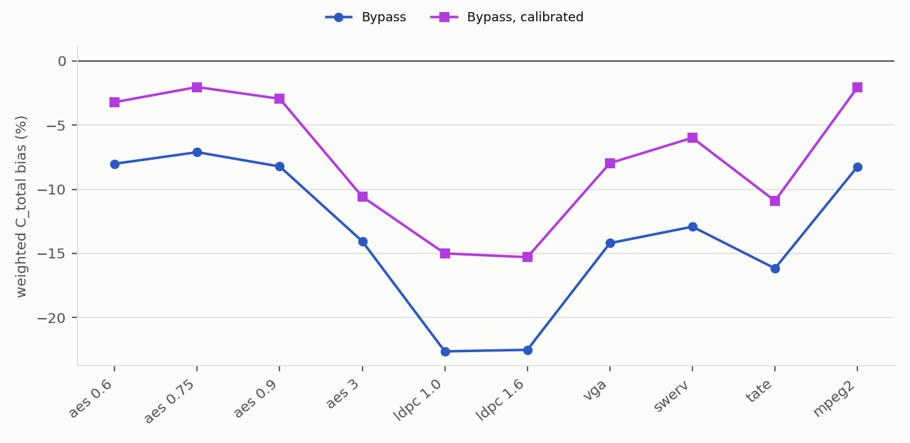

The bias and WMAPE decrease on all ten designs. The two `ldpc_decoder_mod` runs keep the largest bias (−15.0 and −15.3%) because their nets are longer and denser than the nets in the validation runs.

### 4.3 Effect on Timing (PrimeTime)

Source: `sta_analysis/calibration_primetime.csv`.

Endpoint arrival error.

| Design | Median signed (ps), Bypass | Median signed (ps), calibrated | Median absolute (ps), Bypass | Median absolute (ps), calibrated |
|:---|---:|---:|---:|---:|
| aes_cipher_top_0.6_0.4_1.0 | −4.9 | −1.6 | 4.9 | 2.2 |
| aes_cipher_top_0.75_0.4_1.0 | −4.9 | −0.5 | 4.9 | 2.1 |
| aes_cipher_top_0.9_0.4_1.0 | −9.4 | −3.0 | 9.4 | 3.5 |
| aes_cipher_top_3_0.92_1.2 | −12.6 | −8.7 | 12.6 | 8.7 |
| ldpc_decoder_mod_1.0_0.3_1.0 | −59.8 | −35.6 | 59.8 | 35.6 |
| ldpc_decoder_mod_1.6_0.4_1.0 | −97.2 | −34.4 | 97.2 | 34.4 |
| vga_enh_top_1.0_0.6_1.0 | −30.3 | −17.4 | 30.3 | 17.4 |
| swerv_wrapper_1.0_0.7_1.0 | −45.9 | −13.3 | 45.9 | 15.6 |
| tate_pairing_1.0_0.6_1.0 | −39.5 | −18.4 | 39.5 | 18.4 |
| mpeg2_top_1.0_0.6_1.0 | −65.1 | −35.2 | 65.1 | 35.2 |

The ΔWNS before and after calibration is in Table IV ([Section 1.6](#16-worst-slack-table-iv)).

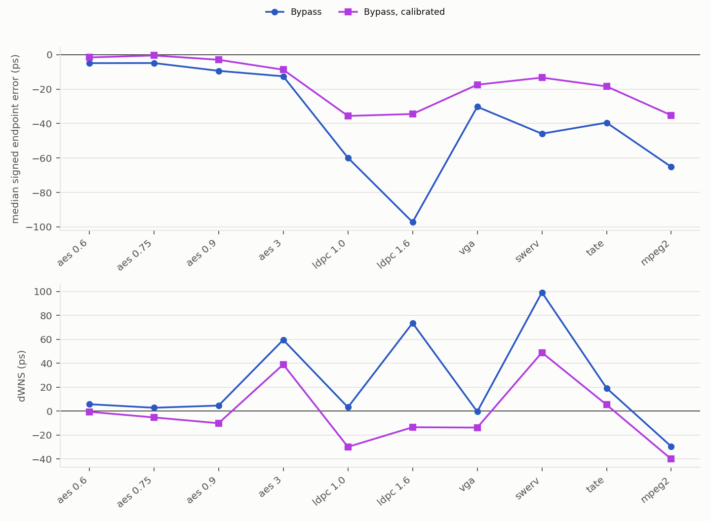

- *The median absolute endpoint error falls on all ten designs* (mean 37.0 to 17.3 ps). Arrivals stay early, with a negative median signed error on all ten.
- *The largest remaining errors are on designs outside the validation range*: `mpeg2_top` (35.2 ps), `ldpc_decoder_mod_1.0_0.3_1.0` (35.6 ps) and `ldpc_decoder_mod_1.6_0.4_1.0` (34.4 ps).
- *ΔWNS improves on average and in the worst case, but not on every design.* Mean \|ΔWNS\| goes from 29.8 to 20.7 ps and the maximum from 99.2 to 48.9 ps. \|ΔWNS\| increases on five designs (`aes_cipher_top_0.75_0.4_1.0`, `aes_cipher_top_0.9_0.4_1.0`, `ldpc_decoder_mod_1.0_0.3_1.0`, `vga_enh_top_1.0_0.6_1.0`, `mpeg2_top_1.0_0.6_1.0`). On all of them the uncalibrated \|ΔWNS\| was already 29.6 ps or less, and the calibrated worst slack becomes pessimistic.
- *Median absolute and median signed error differ after calibration.* Before calibration nearly all endpoints are early, so the two are equal. After it some endpoints are late, so the median absolute error exceeds the absolute median signed error on `aes_cipher_top_0.6_0.4_1.0`, `aes_cipher_top_0.75_0.4_1.0`, `aes_cipher_top_0.9_0.4_1.0` and `swerv_wrapper`.